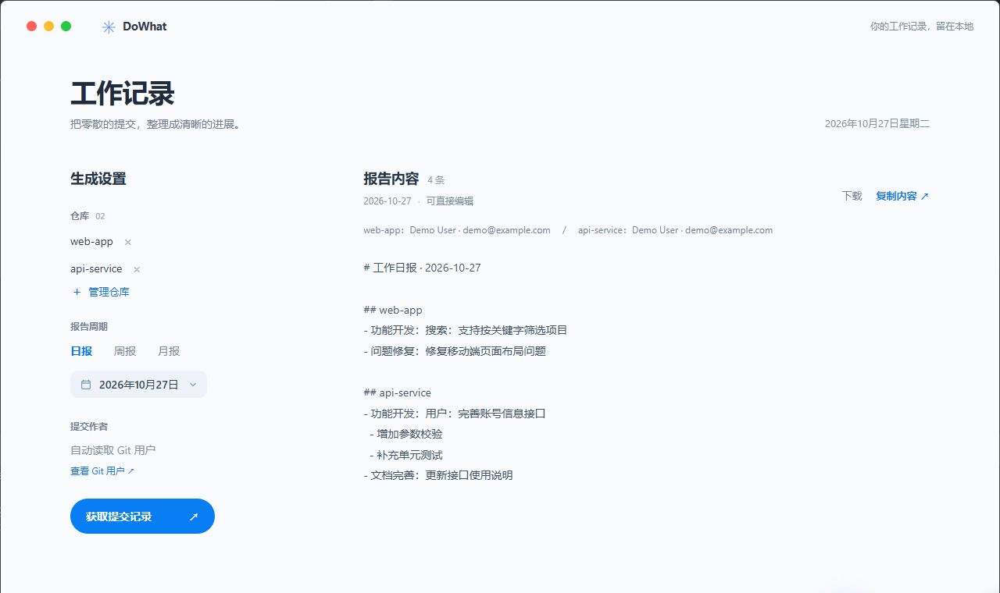
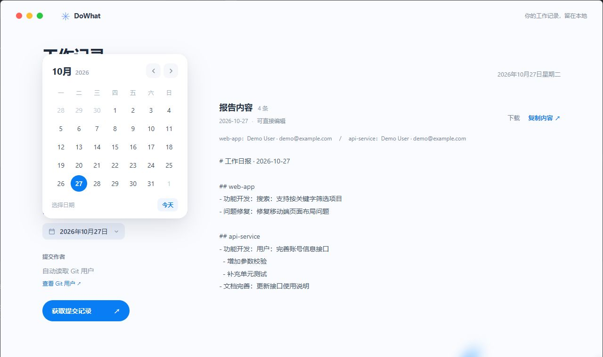
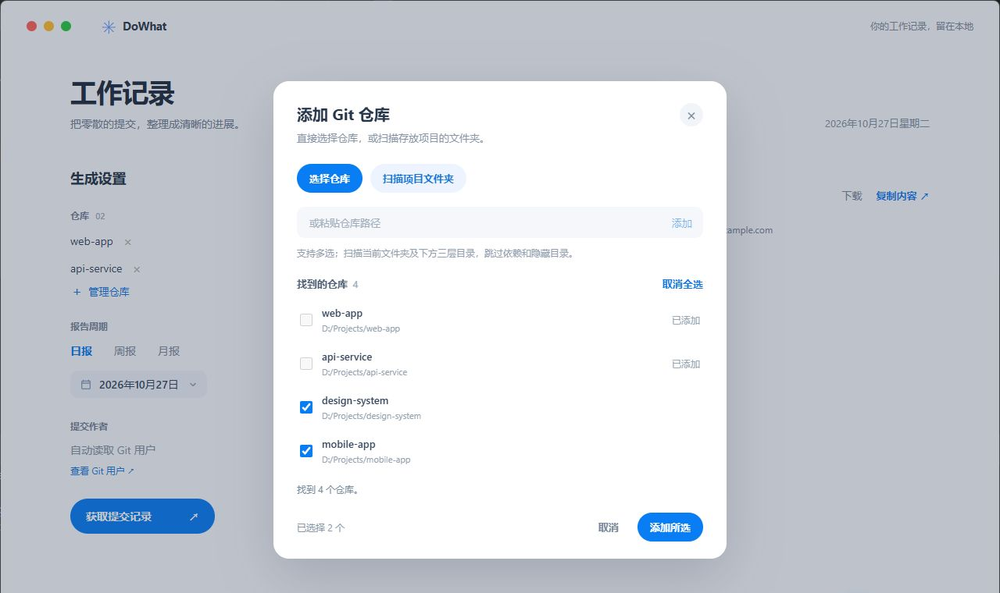

# DoWhat

### 代码写完了，日报也别从失忆开始。

DoWhat 是一个本地 Git 工作记录整理工具：选好仓库和日期，它会帮你把提交记录整理成一份可以编辑、复制和下载的报告。

> 它不负责替你写代码，但可以帮你回答「这周都干了啥」。

## 长什么样

**报告工作台**：选择周期，点一下按钮，工作记录就按项目排好了。



**选日期**：日报、周报、月报，想回哪天就点哪天。



**找仓库**：项目太多也不用一个个翻，可以扫描文件夹后勾选。



截图使用虚构的仓库和提交内容，仅用于展示界面。

## 它能做什么

- **汇总多个仓库**：多选目录、粘贴路径，或者扫描项目文件夹。
- **自动找 Git 用户**：各仓库优先读取 `user.email`，没有邮箱时使用 `user.name`；也可以手动填写作者。
- **选日报、周报或月报**：周报按周一至周日，月报按自然月计算。
- **整理提交记录**：按仓库分段，识别 `feat`、`fix` 等常见提交类型，过滤以 `Merge` 开头的提交和同仓库重复记录。
- **自己说了算**：报告生成后可以直接修改，再复制或下载为 Markdown。

所有整理都在本地进行，不调用 AI，也不会为了生成报告上传代码。你的 Git 提交信息写得越清楚，它整理出来的内容通常也越清楚——毕竟 `fix bug` 暂时还不能自动破译成「今天解决了什么世纪难题」。

## 快速开始

先准备好 Node.js、npm 和 Git，并确保终端里能运行 `git`。然后在项目目录执行：

```bash
npm install
npm run electron:dev
```

启动后：

1. 点击 **选择 Git 仓库**，直接选择、粘贴路径，或选择项目文件夹进行扫描。
2. 勾选需要的仓库并添加。扫描会查看选定目录及下方三层，跳过隐藏目录和常见依赖、构建目录；目录过多时会提前停止并提示。
3. 选择日期和报告周期，点击 **获取提交记录**。
4. 检查并编辑右侧内容，然后复制或下载。写完收工，脑细胞留给下一个需求。

仓库路径可以指向工作目录或其中的子目录，程序会定位到仓库根目录；不要选择单个源代码文件。

## 报告是怎么整理的

程序读取各仓库**当前检出分支**上符合时间范围和作者条件的提交；手动填写的作者使用 Git 的 `--author` 规则匹配。周报和月报中的每条记录会带上提交日期。

例如，以下提交：

```text
feat(用户): 完善账号信息接口 - 增加参数校验 - 补充单元测试
fix: 修复移动端页面布局问题
```

会整理成类似这样：

```markdown
## api-service
- 功能开发：用户：完善账号信息接口
  - 增加参数校验
  - 补充单元测试

## web-app
- 问题修复：修复移动端页面布局问题
```

英文、模块名和未识别的提交前缀会保留。多个 ` - ` 分隔的长提交会拆成子项；如果整理结果不符合你的表达习惯，直接在报告里改就好。仓库读取失败时，页面会显示错误信息。

## 常见问题

**明明提交了，为什么没找到？**

先看看日期、当前分支和提交作者。作者栏留空时，DoWhat 使用各仓库当前配置的 Git 用户信息；如果过去的提交用了不同的邮箱，可以在作者栏手动填写。可在对应仓库的终端运行以下命令查看配置：

```bash
git config --get user.name
git config --get user.email
```

如果用户名和邮箱都没配置，需要先配置 Git 用户，或在应用中手动填写作者。

**为什么扫描不到仓库？**

可以试试直接选择仓库目录或粘贴路径。扫描有深度和数量限制，并会跳过隐藏目录及常见依赖、构建目录；这能避免它在 `node_modules` 里迷路。

**为什么浏览器页面里不能读取 Git？**

`npm run dev` 只启动前端页面；读取本地仓库和保存设置需要 Electron，请使用 `npm run electron:dev`。

## 开发与打包

```bash
npm run build                         # 构建前端
npm run build:electron                # 打包桌面应用，先执行 npm run build
node --test src/utils/report.test.js electron/git.test.cjs
```

项目使用 Vue 3、Vite、Electron 和 simple-git。仓库配置保存在 Electron 的本地用户数据目录中。
